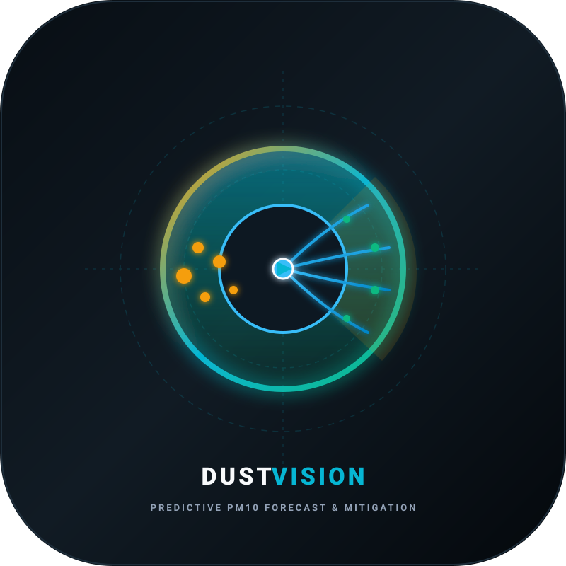
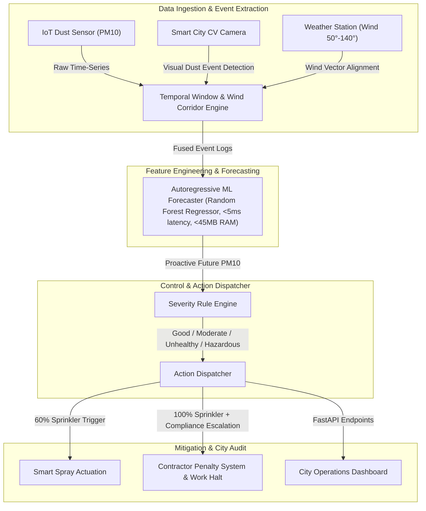

<p align="center">
  
</p>

<h1 align="center">DustVision</h1>

<p align="center">
  <strong>IoT &amp; Computer Vision Predictive PM10 Air Quality Forecasting Engine with Automated Mist Suppression.</strong>
</p>

<p align="center">
  <a href="LICENSE"></a>
  
  
  
  <a href="future.md"></a>
</p>

---

## ⚡ Overview

**DustVision** is an intelligent urban air quality forecasting and mitigation pipeline. Designed for city operations hubs and industrial construction zones, it combines IoT sensor telemetry with spatial computer vision camera alerts and physical wind corridor modeling to predict PM10 spikes up to 30 minutes in advance, autonomously dispatching water-mist suppression cannons before air quality degrades.

---

## 🏗️ System Architecture



---

## ⚡ Core Engineering Pillars

### 1. Temporal Window & Wind Corridor Fusion
*   **Time-Window Matching:** Cross-references raw IoT sensor spikes with spatial computer vision (CV) camera events within a narrow $\pm 2$-minute window.
*   **Wind Corridor Validation:** Verifies dust transport physics by determining if local wind vectors fall within the critical $50^\circ \text{ to } 140^\circ$ urban corridor. True dust events (`label = 1`) are flagged only when sensor spikes, camera alarms, and wind alignment are simultaneously confirmed.

### 2. Proactive Machine Learning Forecasting
*   **Temporal Lag Engineering:** Creates autoregressive features (PM10 lag windows of 5, 15, 30, and 60 minutes) coupled with rolling statistics to act as leading indicators of PM spikes.
*   **Random Forest Regressor:** Optimized for sub-millisecond execution ($<5\text{ms}$), predicting localized PM10 levels up to 30 minutes into the future.

### 3. Severity Actuation & Governance Dispatch
*   **Automated Spray Mapping:** Unhealthy forecasts ($150\text{--}250\ \mu\text{g/m}^3$) trigger automated water mist sprinklers at 60% intensity for 180 seconds.
*   **Contractor Compliance Scoring:** Hazardous forecasts ($>250\ \mu\text{g/m}^3$) trigger 100% spray mitigation, dispatch municipal warnings, and flag heavy earthmoving contractor infractions.

---

## 🚦 Mitigation Thresholds & Rules

```text
  Predicted Future PM10 Concentration (T + 30 mins)
       │
       ├──► [PM10 < 50]                                  ==► GOOD State (Standby)
       ├──► [50 <= PM10 < 150]                           ==► MODERATE State (Active monitoring)
       ├──► [150 <= PM10 < 250]                          ==► UNHEALTHY State (60% Spray + Warnings)
       └──► [PM10 >= 250]                                ==► HAZARDOUS State (100% Spray + Work Halt)
```

---

## 🚀 Quick Start (Under 60 Seconds)

### 1. Install Dependencies
```bash
git clone https://github.com/seeramsujay/dust-vision.git
cd dust-vision
pip install -r requirements.txt
```

### 2. Run ML Forecasting Pipeline
```bash
python pm_forecast.py
```
This saves the serialized model (`rf_pm_forecast.pkl`) and generates:
*   `prediction_plots.png` (actual vs predicted PM10)
*   `impact_simulation.png` (pollution reduction curve)
*   `metrics_table.json` (MAE and RMSE validation metrics)

### 3. Launch FastAPI Prediction Server
```bash
python api.py
```
Open your browser to `http://localhost:8000/docs` to interact with the API endpoints.

---

## 🔮 Engineering Roadmap

To explore planned features including edge RTSP optical density estimation, urban street-canyon CFD simulation, and industrial Modbus/MQTT hardware actuation, read [future.md](future.md).

---

## 📄 License

Distributed under the **MIT License**. See `LICENSE` for details.
